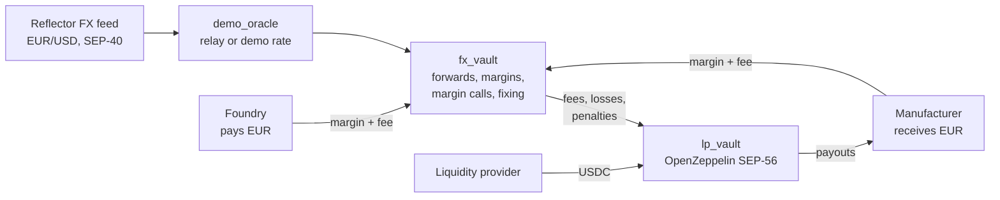

# Zepho

**Lock your EUR/USD rate from order to delivery, settled in USDC on Stellar.**

HackMeridian 2026 · Genesis track (Stellar Composed) · B2B2B

A computer maker pays its chips in dollars and sells to European distributors in euros, a year ahead. If the euro falls 5 %, a 1,000,000 EUR order brings 55,000 USD less. Bank forwards are opaque and need a credit line. Meanwhile, other companies in the same chain pay suppliers in euros and lose when the euro rises: their risks offset, but nothing connects them.

Zepho connects them. A company locks a forward rate on a monthly maturity. Opposite hedges on the same maturity offset each other. A liquidity vault backs only the gap and earns the fees. At maturity, one oracle fixing settles every hedge in USDC, in seconds.

The protocol is infrastructure for a regulated partner (FX broker, bank, payment institution) that runs KYC and distributes it to its business clients: **protocol → regulated partner → manufacturers → their European customers**.

- Live site: **https://zepho.pages.dev**
- Demo film (60 s, Remotion): [video-demo/](video-demo/)
- White paper: [docs/whitepaper.md](docs/whitepaper.md)
- Demo script and pitch: [docs/demo-script.md](docs/demo-script.md)

## How it works



1. **Quote and lock.** `quote` reads the oracle and computes the forward rate K = S₀ × (1 + d × t), with d the USD–EUR interest differential. The company signs `open_hedge` with that K (0.2 % tolerance), pays a 5 % initial margin and a 0.3 % fee. The fee doubles when the hedge widens the maturity's net exposure and halves when it narrows it.
2. **Offset.** Each maturity tracks its net exposure. The vault backs only `|net| × 20 %` and refuses hedges that would engage more than 50 % of its liquidity. LPs can only withdraw what is not engaged.
3. **Margin calls.** Hedges are marked at today's forward rate. Below `loss + 3 %`, anyone can call `margin_call`; the company calls `top_up`, or anyone calls `close_out` after the delay (penalty to the vault).
4. **Fixing and settlement.** After maturity, `fix(T)` stores the oracle record at T, once: the same rate whoever calls and whenever. `settle` pays `N × (K − S_T)` (capped at 20 %) from the vault or from the margin, and returns the rest.

## Stellar building blocks

| Block | Use |
|---|---|
| [Reflector](https://reflector.network) FX feed (SEP-40) | EUR/USD rate at quote, during the hedge, and at fixing (`price(asset, timestamp)`) |
| [OpenZeppelin Stellar Contracts](https://github.com/OpenZeppelin/stellar-contracts) | `lp_vault` is the audited Fungible Token Vault (SEP-56) |
| Stellar Asset Contract | tUSDC (classic asset) used by contracts as a SEP-41 token |
| [Scaffold Stellar](https://scaffoldstellar.org) | Project layout, generated TypeScript clients, React app |
| Stellar Wallets Kit + Freighter | Signing in the browser |

## Testnet deployment

| Contract | Address |
|---|---|
| `fx_vault` | [`CBRJ6VSKB44BSCCJVMYT3CFDXHAEGJUXQFBPSGAW76W6IZCJEZRVR2VH`](https://stellar.expert/explorer/testnet/contract/CBRJ6VSKB44BSCCJVMYT3CFDXHAEGJUXQFBPSGAW76W6IZCJEZRVR2VH) |
| `lp_vault` | [`CDBSXHPF5DYJUUFLLQK2JWRNLBBV7TFYKFTJUPTDTKEAJXFJ7E6ZOTHI`](https://stellar.expert/explorer/testnet/contract/CDBSXHPF5DYJUUFLLQK2JWRNLBBV7TFYKFTJUPTDTKEAJXFJ7E6ZOTHI) |
| `demo_oracle` | [`CBZTPM7A6HJWRMVNLBUQ3C7VSXT2ZMWX5PAWSIC7XAQ72TWIKP332SYJ`](https://stellar.expert/explorer/testnet/contract/CBZTPM7A6HJWRMVNLBUQ3C7VSXT2ZMWX5PAWSIC7XAQ72TWIKP332SYJ) |
| tUSDC (SAC) | [`CA7FJLZBU7I5XIBXTEVP52VIIQG2V3TCFCNTQW2VOELYTSUMGNQQFXGI`](https://stellar.expert/explorer/testnet/contract/CA7FJLZBU7I5XIBXTEVP52VIIQG2V3TCFCNTQW2VOELYTSUMGNQQFXGI) |
| Reflector FX (external) | [`CCSSOHTBL3LEWUCBBEB5NJFC2OKFRC74OWEIJIZLRJBGAAU4VMU5NV4W`](https://stellar.expert/explorer/testnet/contract/CCSSOHTBL3LEWUCBBEB5NJFC2OKFRC74OWEIJIZLRJBGAAU4VMU5NV4W) |

All addresses, including the demo accounts: [deployments/testnet.json](deployments/testnet.json).

Demo parameters: d = 1.5 %, initial margin 5 %, maintenance 3 %, cap 20 %, vault max loss 50 %, fee 0.3 % (×2 / ×0.5), margin call delay 120 s, penalty 1 %, oracle max age 900 s.

## Run it

Requirements: Rust with the `wasm32v1-none` target, [Stellar CLI](https://developers.stellar.org/docs/tools/cli) 28+, `stellar-scaffold-cli`, Node 22 (`.nvmrc`).

```bash
npm install
STELLAR_NETWORK=testnet stellar scaffold build   # generate clients for the testnet contracts
cd app && npx vite                                # http://localhost:5173
```

Live site: **https://zepho.pages.dev**. One page presents Zepho (the Zepho stack, pricing read from the contract, about). **Launch App** opens `/connect`, where you pick a persona; each persona has its terminal:

- **Manufacturer / Foundry**: Corporate Terminal: quote, **Lock Rate & Deposit Margin**, active positions with margin health, **Start Margin Call**, **Top Up Collateral**, **Settle**.
- **Liquidity Provider**: vault KPIs, net exposure per side, **Deposit** / **Withdraw**.
- **Operator**: oracle rate (presets, **Back to Reflector**), **Open Maturity**, **Record Fixing**, **Settle**, **Close Out** after an expired margin call.

Signing needs Freighter on testnet with the matching demo account (see [docs/demo-script.md](docs/demo-script.md)); any page can be browsed without a wallet.

### Deploy

The site is hosted on Cloudflare Pages (project `zepho`). After a change, from the repository root:

```bash
nvm use                                 # Node 22, from .nvmrc
npx wrangler@4.152.0 login              # once per machine
npm run deploy                          # build app/ and publish to https://zepho.pages.dev
```

## Tests

```bash
cargo test --workspace                 # 32 contract tests
cd e2e && npx playwright test smoke    # 7 UI smoke tests
```

`e2e/tests/fx-demo.spec.ts` plays the whole demo in Chromium against testnet, with real transactions: deposit, two opposite hedges, euro dip, margin call, top-up, fixing, settlement. It needs the demo accounts' secret keys:

```bash
cd e2e
FX_E2E=1 FX_ADMIN=$(stellar keys show admin) FX_FABRICANT=$(stellar keys show fabricant) \
FX_FONDEUR=$(stellar keys show fondeur) FX_APPORTEUR=$(stellar keys show apporteur) \
npx playwright test fx-demo
```

## Repository

```
contracts/
  fx_vault/      forwards, margins, margin calls, fixing, settlement
  lp_vault/      liquidity provider vault (OpenZeppelin SEP-56)
  demo_oracle/   Reflector-compatible oracle: relay or demo rate
app/             React app (Scaffold Stellar, Tailwind): site and terminals
app-lib/         wallet, network, generated contract clients
e2e/             Playwright tests
deployments/     testnet addresses
docs/            white paper, demo script
brand/           logo files
video-demo/      60 s demo film (Remotion, real captures)
video/           earlier HyperFrames film draft
```

## Demo film

60 s, 1920x1080, no voiceover, built from real captures of the site and of a testnet run: brand, quote, lock, netting, margin call and top-up, fixing and settlement, cost vs. risk, logo. Source and render steps: [video-demo/README.md](video-demo/README.md).

## Limits of the prototype

- Testnet only, no audit. The demo oracle lets the operator set the rate to replay a move of the euro.
- Demo maturities last minutes but are priced as 360 days.
- d is set by hand; the forward is not discounted; KYC is simulated.
- A forward sold to companies is a regulated derivative in Europe (EMIR, MiFID II): production requires a regulated partner and legal review.

## Roadmap

Pilot with one regulated partner and two companies with opposite exposures · yield on idle liquidity and margins via Blend · early close-out and maturity roll · vault net hedging with EURC on the Stellar DEX · financing of hedged receivables · TWD and other supply-chain currencies.

## License

MIT
