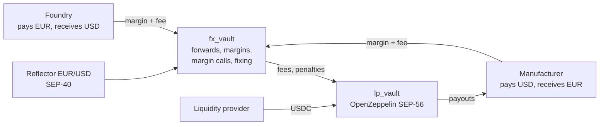

# Zepho

**Lock your EUR/USD rate from order to delivery, settled in USDC on Stellar.**

HackMeridian 2026 · Genesis track · B2B2B · **Live: https://zepho.pages.dev**

## The problem

80% of mid-size firms lost money on unhedged currency risk in 2025 (MillTech, 2026). In the chip supply chain the risk runs both ways: a computer maker **pays USD** for chips and **receives EUR** from European sales; a foundry **pays EUR** for European equipment and **receives USD**. One loses when the euro falls, the other when it rises, and bank forwards are opaque and need a credit line.

## The solution

Zepho connects the two sides. A company locks a forward rate on a monthly maturity with a 5% margin, no credit line. Opposite hedges offset; a liquidity vault backs only the net and earns the fees. Margin calls and one oracle fixing per maturity run on-chain, and settlement is in USDC in seconds. A regulated FX partner distributes it (protocol → partner → companies).



1. **Quote and lock**: K = S₀ × (1 + d × t) from Reflector; 5% margin; fee 0.15–0.60% depending on whether the hedge balances the maturity.
2. **Offset**: net exposure per maturity; the vault backs at most 50% of its liquidity.
3. **Margin calls**: hedges marked at today's forward; below `loss + 3%` anyone can call, then `top_up` or `close_out`.
4. **Fixing and settlement**: `fix(T)` stores the oracle record at T once; `settle` pays in USDC.

## Built with

| | |
|---|---|
|  [Stellar](https://stellar.org) ·  [Soroban](https://developers.stellar.org/docs/build/smart-contracts) | Three smart contracts, settlement in ~5 s |
|  [Reflector](https://reflector.network) | EUR/USD oracle (SEP-40): quote, marking, fixing |
|  [OpenZeppelin Stellar Contracts](https://github.com/OpenZeppelin/stellar-contracts) | `lp_vault` = audited Fungible Token Vault (SEP-56) |
|  [USDC](https://www.circle.com/usdc) | Margins, fees and payouts (tUSDC via the Stellar Asset Contract on testnet) |
|  [Freighter](https://www.freighter.app) · [Scaffold Stellar](https://scaffoldstellar.org) | Wallet signing, React app and generated clients |

## Links

- Live app: https://zepho.pages.dev
- Demo film (60 s): [video-demo/](video-demo/)
- White paper: [docs/whitepaper.md](docs/whitepaper.md) · Demo script: [docs/demo-script.md](docs/demo-script.md)

## Testnet contracts

| Contract | Address |
|---|---|
| `fx_vault` | [`CBRJ6VSK…R2VH`](https://stellar.expert/explorer/testnet/contract/CBRJ6VSKB44BSCCJVMYT3CFDXHAEGJUXQFBPSGAW76W6IZCJEZRVR2VH) |
| `lp_vault` | [`CDBSXHPF…OTHI`](https://stellar.expert/explorer/testnet/contract/CDBSXHPF5DYJUUFLLQK2JWRNLBBV7TFYKFTJUPTDTKEAJXFJ7E6ZOTHI) |
| `demo_oracle` | [`CBZTPM7A…2SYJ`](https://stellar.expert/explorer/testnet/contract/CBZTPM7A6HJWRMVNLBUQ3C7VSXT2ZMWX5PAWSIC7XAQ72TWIKP332SYJ) |
| tUSDC (SAC) | [`CA7FJLZB…FXGI`](https://stellar.expert/explorer/testnet/contract/CA7FJLZBU7I5XIBXTEVP52VIIQG2V3TCFCNTQW2VOELYTSUMGNQQFXGI) |

All addresses and demo accounts: [deployments/testnet.json](deployments/testnet.json).

## Run, test, deploy

Rust (`wasm32v1-none`), [Stellar CLI](https://developers.stellar.org/docs/tools/cli) 28+, `stellar-scaffold-cli`, Node 22 (`.nvmrc`).

```bash
npm install
STELLAR_NETWORK=testnet stellar scaffold build   # clients for the testnet contracts
cd app && npx vite                                # http://localhost:5173

cargo test --workspace                            # 32 contract tests
cd e2e && npx playwright test smoke               # UI smoke tests
npm run deploy                                    # publish to https://zepho.pages.dev (Cloudflare Pages)
```

`e2e/tests/fx-demo.spec.ts` runs the full cycle against testnet with real transactions (deposit, two opposite hedges, margin call, top-up, fixing, settlement); it needs the demo accounts' keys (`FX_E2E=1 FX_ADMIN=… npx playwright test fx-demo`).

```
contracts/   fx_vault · lp_vault · demo_oracle (Soroban)
app/         site and persona terminals (React, Tailwind)
e2e/         Playwright tests
video-demo/  60 s demo film (Remotion)
docs/        white paper, demo script
```

## Roadmap

1. **Pilot** with one regulated FX partner and one company on each side of a maturity, after an audit.
2. **AI treasury agent**: reads invoices and orders, detects EUR/USD exposure and proposes the hedge to sign.
3. **Yield** on idle liquidity (Blend) and vault net hedging with EURC on the Stellar DEX.
4. **More currencies** for the supply chain (TWD, JPY, CNY).

## License

MIT
